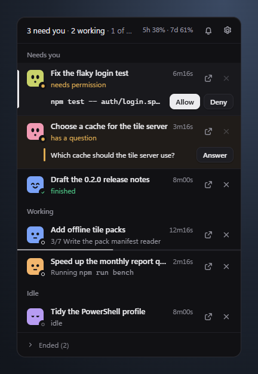

<p align="center"></p>

<h1 align="center">Beacon</h1>

<p align="center">Every Claude Code session on your PC in one small panel. Answer permission prompts,<br>questions and plan approvals without hunting for the right window.</p>

<p align="center">
  
  
</p>

## Install

1. Download `Beacon-<version>-setup.exe` from [Releases](https://github.com/Project-Graphite/beacon/releases).
2. Run it. It installs for your user only, so no administrator rights are needed. The installer is
   not code-signed yet, so Windows SmartScreen may warn: choose **More info**, then **Run anyway**.
3. Answer **Yes** to *Connect Beacon to Claude Code*. This adds Beacon's hooks to your Claude Code
   settings (`%USERPROFILE%\.claude\settings.json`); a backup is kept and uninstalling restores it.

Beacon starts in the tray and shows itself whenever Claude is working or needs you. Running Claude
sessions pick up the hooks without a restart.

Requires Windows 11 and Claude Code 2.1.3xx. Prefer no installer? The release also has a zip: keep
the three executables together, run `beacon.exe install --yes`, then start `beacon-app.exe`.

## How it works

Claude Code runs Beacon's small helper for each hook event. The helper hands the event to Beacon and,
for a permission request, waits for your answer. When Beacon is not running, the helper steps aside
at once and Claude Code behaves exactly as it does without Beacon.

## The overlay

A small always-on-top pill shows one mark per session, how many need you, and an arrow that opens the
panel. Pick the **edge tab** instead for a 4 px strip on a screen edge. Both follow the Windows light
or dark theme.

| Mark | Meaning |
|---|---|
| Rotating arc | Working |
| Circle with a halo | Needs you: a permission, a question, a plan or an MCP form |
| Pause | Stalled: working, but quiet for longer than you set |
| Check | Finished |
| Triangle | API error |
| Ring | Idle |

- **Pill background: None** leaves only the marks floating on your desktop.
- **Show it: Only when Claude needs you** keeps the overlay invisible until a session waits on you;
  with **Reveal on hover**, resting the pointer on its spot brings it back.
- When a session starts needing you, the overlay pulses and slides out a short label naming it. It
  never takes focus, and the session you are looking at gets no alert.

## The panel

Open it from the pill's arrow, the edge tab, the tray icon or your shortcut. Sessions are grouped by
state, each with its title, its progress and its current step. Open one to see its plan, recent
activity, the command it is running, its last message and usage, and a box to send it a prompt.

### Answering requests

- **Allow**, **Deny** or **Deny with message**. Nothing is ever sent without a click or a key press on
  that request, and there is no "allow all".
- **Always allow…** saves an ordinary Claude Code permission rule for the session, the project or
  all your projects. Beacon keeps no rules of its own.
- A request that looks destructive (recursive deletes, force pushes, download-and-run and similar)
  is flagged, needs a second deliberate press, and never offers Always allow.
- Secrets in a request stay masked until you ask to see them.
- Questions show their options plus **Other**; plans show their text with **Approve**, **Keep
  planning** and **Reject with feedback**.

### Sending a prompt

| Session | What happens |
|---|---|
| Working | The prompt is queued and handed to Claude when the turn ends |
| Idle | Beacon wakes the session and Claude starts a new turn |
| Idle, and it cannot be woken | The text goes to your clipboard and Beacon jumps to the window |

### Hide

The ✕ on a session hides it from the panel and the overlay until its next prompt or request; **Undo**
or **Show** brings it back. Hiding never closes the session itself.

### Keyboard

| Where | Keys |
|---|---|
| A request | `A` allow · `D` deny · `M` deny with message · `Tab` next request |
| The list | `↑` `↓` select · `Enter` open · `a` acknowledge · `s` snooze 5 min · `j` jump · `x` hide · `/` prompt |
| A session | `Esc` back · `[` `]` previous or next session · `j` jump · `x` hide · `/` prompt |

## Settings

Everything is in the panel's settings (the gear) and the most used choices are also in the tray menu,
under the same names: **Overlay** (style, pill background, when to show it, size, display, position),
**Attention** (pulse and label, reminders, notifications, sounds), **Startup** (start with Claude, at
sign-in or manually, and close when unused), **Behaviour** (headless runs, stalled after, clear
finished after, and the shortcut, which you record by pressing it) and **Claude Code hooks**.

## Command line

`beacon.exe` sits next to the app.

| Command | What it does |
|---|---|
| `beacon status [--watch] [--json] [--all]` | Lists sessions and pending requests |
| `beacon decide <id> allow` / `deny [--message <text>] [--stop]` | Answers a request |
| `beacon decide <id> answer "<question>=<label>" ...` | Answers a question |
| `beacon decide <id> always "<Tool(specifier)>" [--scope session\|local\|project\|user]` | Allows and saves a rule |
| `beacon prompt <session> "<text>"` | Queues or wakes a session with a prompt |
| `beacon ack`, `snooze`, `unsnooze`, `dismiss`, `undismiss`, `jump`, `where` `<session>` | Acknowledge, snooze, hide, bring back, jump to or locate a session |
| `beacon usage [--refresh]` | Token use per session and your account limits |
| `beacon install` / `uninstall [--yes]` | Shows, then applies, the hook change |
| `beacon doctor` | Checks the hooks, the core and a helper round trip |
| `beacon daemon` / `stop` | Runs or stops the core without the app |

`<session>` is a session id or a unique prefix of one. Decisions are refused from inside a Claude
session, so a session cannot approve its own requests through the command line.

## Privacy and safety

- Beacon makes no network connections. Refreshing usage runs one `claude -p` request through Claude
  Code, only when you ask.
- The helper talks to Beacon over a named pipe that only your user can open, with a random token.
- It fails open: if Beacon is slow, stopped or crashed, Claude Code carries on as if Beacon were not
  there.
- Previews, titles and activity lines are redacted before anything is shown.
- Data lives in `%LOCALAPPDATA%\Beacon`: settings, session state, logs and settings backups.

## Uninstall

**Settings › Apps › Installed apps › Beacon › Uninstall.** The uninstaller removes Beacon's hooks
from Claude Code, its startup entry, and, if you choose, its data folder.

## Build from source

Needs Rust 1.100 or later and Node with npm.

```powershell
cd app
npm install
npx tauri build --no-bundle -- --profile fast
cd ..
cargo build --profile fast -p beacon-cli -p beacon-hook
```

The binaries land in `target\fast\`. `scripts\release.ps1` builds the installer, the zip and their
checksums into `dist\`. `npm --prefix app run preview:panel` opens the panel in a browser with
sample sessions.

## Limits

- Verified end to end with headless `claude -p` runs and on the desktop app's Code tab. The terminal
  and the VS Code extension are built for but not yet verified.
- Waking an idle session is verified on the desktop Code tab; in VS Code it falls back to the
  clipboard when VS Code will not take the prompt.
- MCP input forms are shown but answered in the session window.
- Notifications have no action buttons.
- Usage and titles come from Claude Code's transcripts and cache, whose formats are internal and can
  change.

## More

[DESIGN.md](DESIGN.md) describes the look and its tokens. [docs/DECISIONS.md](docs/DECISIONS.md)
records the design decisions and what was verified, and [docs/SPIKES.md](docs/SPIKES.md) the
experiments behind them.
