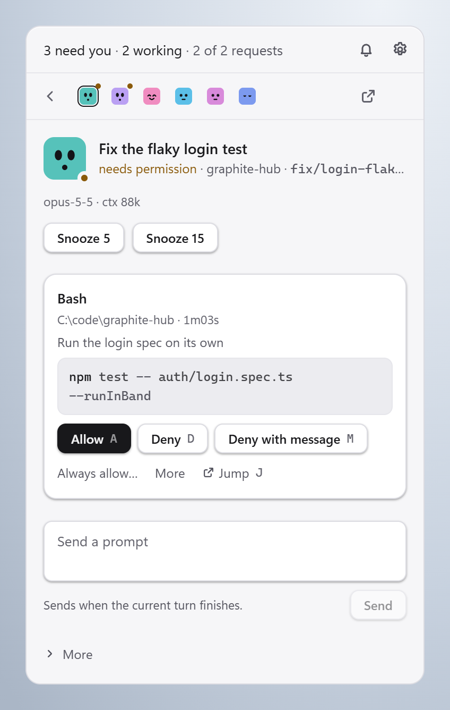

<p align="center"></p>

<h1 align="center">Beacon</h1>

<p align="center">Every Claude Code session on your PC in one small panel. Answer permission prompts,<br>questions and plan approvals without hunting for the right window.</p>

<p align="center">
  <a href="https://github.com/Project-Graphite/beacon/releases/latest"></a>
  <a href="LICENSE"></a>
  
</p>

<p align="center">
  
  
</p>

## What it does

- Shows every running Claude Code session, its state and its progress, in one place.
- Answers permission prompts, questions and plan approvals from that place.
- Sends a session a prompt, now or when its turn ends.
- Fails open: when Beacon is slow, stopped or crashed, Claude Code carries on as if it were not there.

## Install

Requires Windows 11 and Claude Code 2.1.328 or later (tested with 2.1.330).

1. Download `Beacon-<version>-setup.exe` from [Releases](https://github.com/Project-Graphite/beacon/releases).
   To check the download, compare `Get-FileHash .\Beacon-<version>-setup.exe` with the line for it in
   the release's `SHA256SUMS.txt`.
2. Run it. It installs for your user only, so no administrator rights are needed. The installer is
   not code-signed yet, so Windows SmartScreen may warn: choose **More info**, then **Run anyway**.
3. Answer **Yes** to *Connect Beacon to Claude Code now?* This adds Beacon's hooks to your Claude Code
   settings (`%USERPROFILE%\.claude\settings.json`, or `settings.json` in `CLAUDE_CONFIG_DIR` when
   that is set) and keeps a backup of the file.

Beacon installs into `%LOCALAPPDATA%\Beacon\app` and starts in the tray. `beacon.exe` is not added
to your PATH, so run the command-line examples below from that folder or by full path. A silent
install (`Beacon-<version>-setup.exe /S`) connects the hooks without asking.

Prefer no installer? The release also has `beacon-<version>-windows-x64.zip`: keep the three
executables together, run `beacon.exe install --yes`, then start `beacon-app.exe`. To remove it, run
`beacon.exe uninstall --yes` and delete the folder (see [Uninstall](#uninstall)).

## How it works

Claude Code runs Beacon's small helper for each hook event. The helper hands the event to Beacon and,
for a permission request, waits for your answer. When Beacon is not running, the helper steps aside
at once and Claude Code behaves exactly as it does without Beacon.

## The overlay

By default Beacon shows an **edge tab**: a 4 px strip on a screen edge, coloured by the overall
state: amber when a session needs you or has stalled, red after an API error, green when one has
finished, and the theme's text colour while one works. It is on screen while Claude is active: a
session is starting, working, stalled or needs you, or has news you have not looked at. Hovering it
opens the panel; a click keeps the panel open.

The other style is the **pill**: one mark per session (up to ten, then `+N`), a count of the sessions
that need you, and an arrow that opens the panel. Drag it to move it. Both styles follow the Windows
light or dark theme and hide while a fullscreen window is in front on their display.

| Mark | Meaning |
|---|---|
| Small dot | Starting |
| Rotating arc | Working |
| Circle with a halo | Needs you: a permission, a question, a plan or an MCP form |
| Pause | Stalled: working, but quiet for longer than you set |
| Check | Finished |
| Triangle | API error |
| Ring | Idle |

- **Show it** chooses when the overlay is on screen: **Always**, **While Claude is active** (the
  default), **Only when Claude needs you** or **Never** (tray icon only). With **Reveal on hover**,
  resting the pointer on a hidden overlay's spot brings it back.
- **Pill background: None** leaves only the marks floating on your desktop.
- When a session starts needing you, the overlay pulses and slides out a short label naming it, and
  the pulse repeats every minute (**Remind me**) until you open the panel. The overlay never takes
  focus. The label and the Windows notification skip the session whose window is in front; the
  pulse and sounds do not.
- Invisible parts of the overlay still catch clicks on their own small area: the strip that reveals
  a hidden overlay (a 4 px band at the pill's spot, or the tab's 8 px footprint), the 8 px band
  around the 4 px tab, and a pill with no background.

## The panel

Open it from the edge tab, the pill's arrow, the tray icon or the shortcut, `Ctrl+Alt+Space` by
default (change it under Settings › Behaviour › Shortcut). Sessions are grouped by state, each with
its title, its progress and its current step. Open one to see its plan, recent activity, the command
it is running, its last message and usage, and a box to send it a prompt.

With **Pin panel while Claude is active** (off by default) the panel opens by itself without taking
focus while a session is starting, working, stalled or needs you, closes 5 s after Claude is done,
and steps aside for a fullscreen window.

### Answering requests

- **Allow**, **Deny** or **Deny with message**; **More** adds **Deny and stop Claude**. Nothing is
  ever sent without a click or a key press on that request, and there is no "allow all".
- **Always allow…** saves an ordinary Claude Code permission rule for this session, this project
  (only you or shared) or all your projects. Beacon keeps no rules of its own.
- A request that looks destructive (recursive deletes, force pushes, download-and-run and similar)
  is flagged, needs a second deliberate press, and never offers Always allow.
- Secrets in a tool request stay masked until you press **Show unmasked**.
- Questions show their options plus **Other**; plans show their text with **Approve plan**, **Keep
  planning** and **Reject with feedback**.

### Sending a prompt

| Session | What happens |
|---|---|
| Working or waiting on you | The prompt is queued and handed to Claude when the turn ends |
| Idle | Beacon wakes the session and Claude starts a new turn |
| Idle in VS Code, and it cannot be woken | The session opens in VS Code with the text in its prompt box and on your clipboard |
| Idle elsewhere, and it cannot be woken | The text goes to your clipboard and Beacon jumps to the window |

### Hide

The ✕ on a session hides it from the panel and the overlay until its next prompt or request; **Undo**
or **Show** brings it back. Hiding never closes the session itself.

### Keyboard

| Where | Keys |
|---|---|
| A request | `A` allow · `D` deny · `M` deny with message · `Tab` next request |
| The list | `↑` `↓` select · `Enter` open · `a` acknowledge · `s` snooze 5 min · `j` jump · `x` hide · `/` prompt |
| A session | `Esc` back · `[` `]` previous or next session · `j` jump · `x` hide · `/` prompt |

## Settings

The panel's settings (the gear) hold everything, in six sections: **Overlay** (style, pill
background, when to show it, reveal and open on hover, size, idle opacity, display, position and
pinning), **Attention** (pulse and label, reminders, notifications, sounds and a preview),
**Startup** (start when Claude is used, at sign-in or only when you open it, and close when unused),
**Behaviour** (headless runs, stalled after, clear finished after, and the shortcut, which you record
by pressing it), **Claude Code hooks** (install, repair or uninstall, with the change shown first) and
**About**.

The tray menu repeats the most used ones under the same names: **Overlay** (style, pill background,
show it, size, display, never show on, position, reveal on hover, open panel on hover) and
**Attention** (notifications, also when finished, sounds). It also has **Open Beacon**, **Snooze**
(5 minutes, 15 minutes, 1 hour, or end the snooze), **Settings…** and **Quit Beacon**. A left click
on the tray icon opens or closes the panel.

## Command line

`beacon.exe` sits next to the app in `%LOCALAPPDATA%\Beacon\app`.

| Command | What it does |
|---|---|
| `beacon status [--watch] [--json] [--all]` | Lists sessions and pending requests |
| `beacon decide <id> allow` / `deny [--message <text>] [--stop]` | Answers a request |
| `beacon decide <id> answer "<question>=<label>" ...` | Answers a question |
| `beacon decide <id> always "<Tool(specifier)>" [--scope session\|local\|project\|user]` | Allows and saves a rule |
| `beacon prompt <session> "<text>"` | Queues a prompt or wakes the session with it |
| `beacon ack`, `dismiss`, `undismiss`, `jump`, `where` `<session>` | Acknowledge, hide, bring back, jump to or locate a session |
| `beacon snooze <session\|all> <minutes>` / `unsnooze <session\|all>` | Snoozes or ends the snooze of one session or all |
| `beacon usage [--refresh]` | Token use per session and your account limits |
| `beacon install` / `uninstall [--settings <path>] [--yes]` | Shows, then applies, the hook change |
| `beacon doctor [--settings <path>]` | Checks the hooks, the core and a helper round trip |
| `beacon daemon` / `stop` | Runs or stops the core without the app |

`<session>` is a session id or a unique prefix of one. `--settings` points at a Claude Code settings
file other than the default. Decisions and prompts are refused from inside a Claude session, so a
session cannot approve its own requests or prompt itself through the command line.

## Privacy and safety

- Beacon's own code makes no network connections. Refreshing usage runs one `claude -p` request
  through Claude Code, only when you ask. The installer downloads Microsoft's WebView2 runtime if it
  is missing.
- The helper talks to Beacon over a named pipe that only your user can open, with a random token.
- It fails open: if Beacon is slow, stopped or crashed, Claude Code carries on as if Beacon were not
  there.
- Secrets are redacted where Beacon first stores the text: request previews, titles, activity lines,
  the last message, MCP form messages and API errors. `beacon status --json` redacts request inputs,
  plans and queued prompts, and the install and uninstall plans redact the settings lines they show.

Beacon keeps its data in `%LOCALAPPDATA%\Beacon`:

| Path | What it holds |
|---|---|
| `app\` | The installed programs |
| `bin\` | `beacon-hook.exe`, the helper Claude Code runs |
| `config.json` | Core settings, such as headless runs, stalled after and clear finished after |
| `ui.json` | App settings, overlay positions and the shortcut |
| `state.json` | Sessions, queued prompts and snoozes, so they survive a restart |
| `logs\core.log`, `logs\app.log` | Logs, each moved to `.1` before it passes 5 MB |
| `backups\` | Copies of your Claude Code settings file from install and uninstall |
| `install.json` | Which settings file the hooks went into, and its backup |
| `endpoint`, `autostart`, `icon.png` | The pipe name and token, the start-with-Claude marker, the notification icon |

The panel's WebView2 profile lives in `%LOCALAPPDATA%\com.project-graphite.beacon`.

## Uninstall

**Settings › Apps › Installed apps › Beacon › Uninstall.** The uninstaller removes Beacon's hooks
from Claude Code, its startup entry and its notification registration, and, if you choose, the data
folder and the WebView2 profile. If it cannot remove the hooks, it says so and keeps the data folder.

Removing the hooks restores your settings file byte for byte when it is unchanged since install.
Otherwise only Beacon's handlers are taken out and the rest of the file is kept.

Choosing **Uninstall** on the setup program's own maintenance page (running the installer again)
leaves the hooks in place. Use Settings › Apps, or run `beacon.exe uninstall --yes` first.

For the zip, run `beacon.exe uninstall --yes`, quit Beacon, and delete its folder,
`%LOCALAPPDATA%\Beacon` and `%LOCALAPPDATA%\com.project-graphite.beacon`. If you chose to start
Beacon at sign-in, set Startup to **Only when I open it** first so the startup entry is removed. The
notification registration under `HKCU\Software\Classes\AppUserModelId` is left behind.

## Limits

- Verified end to end with headless `claude -p` runs and on the desktop app's Code tab. The terminal
  and the VS Code extension are built for but not yet verified.
- Waking an idle session is verified only on the desktop Code tab.
- MCP input forms are shown but answered in the session window.
- Notifications have no action buttons.
- Usage and titles come from Claude Code's transcripts and cache, whose formats are internal and can
  change.
- The overlay's invisible hit areas (see [The overlay](#the-overlay)) catch clicks meant for what
  lies beneath them.

## Development

Prerequisites: Rust 1.100 or later, Node 22.18 or later with npm, and Visual Studio Build Tools with
the C++ workload (see [Tauri's Windows prerequisites](https://v2.tauri.app/start/prerequisites/#windows)).
The Node floor comes from the app's tests, which `node --test` runs as `.ts` files directly.

```powershell
cd app
npm install
npx tauri build --no-bundle -- --profile fast
cd ..
cargo build --profile fast -p beacon-cli -p beacon-hook
```

The binaries land in `target\fast\`.

| Path | What it is |
|---|---|
| `crates/protocol` | The wire format shared by the helper, the core and its clients |
| `crates/hook` | `beacon-hook.exe`, the helper Claude Code runs for each hook event |
| `crates/core` | The core: session registry, state machine, decision broker and pipe server |
| `crates/cli` | `beacon.exe`: the command line, the hook installer and doctor |
| `app/` | The panel, in React and TypeScript |
| `app/src-tauri/` | `beacon-app.exe`: the native host, tray, overlay and panel window |
| `fixtures/` | Sanitised hook payloads from real Claude Code runs |
| `spikes/` | The scripts behind the phase 0 experiments |
| `scripts/` | The release script |
| `docs/` | The design log and the spike results |

Run the Rust tests per crate with Beacon's and Claude Code's folders pointed at temporary ones, so
your real profile is untouched, and the panel's tests with npm:

```powershell
$env:BEACON_HOME = "$env:TEMP\beacon-test\home"
$env:CLAUDE_CONFIG_DIR = "$env:TEMP\beacon-test\claude"
$env:WEBVIEW2_USER_DATA_FOLDER = "$env:TEMP\beacon-test\webview"
cargo test -p beacon-core
npm --prefix app test
```

`npm --prefix app run preview:panel` opens the panel in a browser with sample sessions.

`scripts\release.ps1` refuses a working tree with uncommitted or untracked changes, takes the version
from the workspace `Cargo.toml`, and builds the installer, the zip and `SHA256SUMS.txt` into `dist\`.

## More

- [DESIGN.md](DESIGN.md): the visual design reference, with its tokens.
- [docs/DECISIONS.md](docs/DECISIONS.md): the dated design log, newest first.
- [docs/SPIKES.md](docs/SPIKES.md): the phase 0 experiment results, kept as a record.

## Licence

MIT, see [LICENSE](LICENSE).
